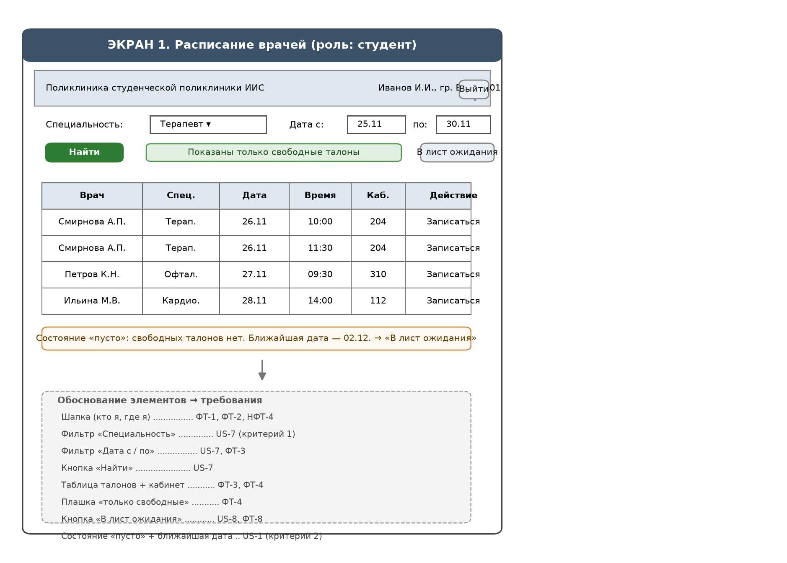
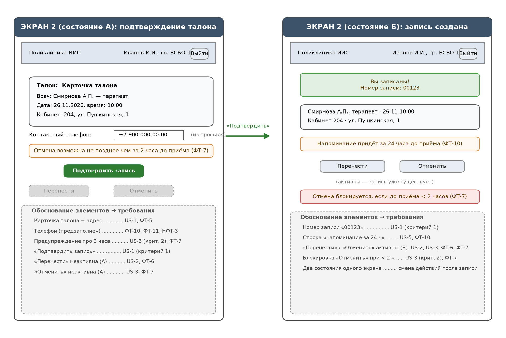
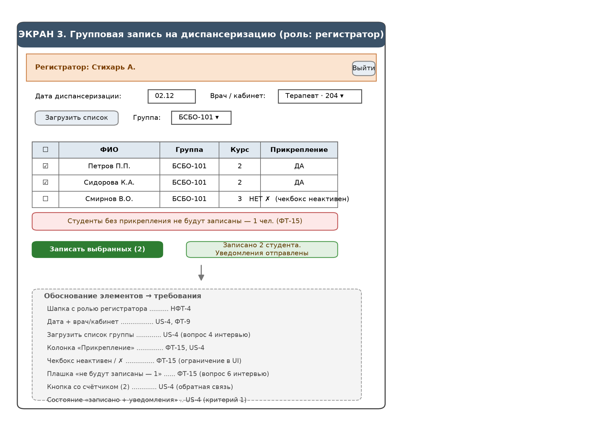

# Эскизный прототип ИС «Запись к врачу»

Эскизы выполнены в wireframe-инструменте. Каждый экран сверен с пользовательскими историями из `user-stories.md`.
*Примечание: профессиональное каркасное прототипирование (с эвристиками Нильсена) выполняется весной в рамках дисциплины «Проектирование информационных систем» — здесь представлена эскизная проверка историй.*

---

## Экран 1. Расписание врачей (роль: студент)

**Файл:** `screen1_schedule.png`  
**Обслуживает истории:** US-7 (просмотр расписания), US-1 (запись на приём), US-8 (лист ожидания).

**Обоснование элементов → требования:**
- Шапка (кто я, где я) → ФТ-1, ФТ-2, НФТ-4.
- Фильтр «Специальность» → US-7 (критерий 1).
- Фильтр «Дата с / по» → US-7, ФТ-3.
- Кнопка «Найти» → US-7.
- Таблица талонов + кабинет → ФТ-3, ФТ-4.
- Плашка «только свободные» → ФТ-4.
- Кнопка «В лист ожидания» → US-8, ФТ-8.
- Состояние «пусто» + ближайшая дата → US-1 (критерий 2).

---

## Экран 2. Подтверждение и управление записью (роль: студент)

**Файлы:** `screen2_confirm.png`  
**Обслуживает истории:** US-1 (запись), US-2 (перенос), US-3 (отмена), US-5 (напоминание).
**Особенность:** показаны два состояния одного экрана (до и после записи).

**Обоснование элементов → требования:**
- Карточка талона + адрес → US-1, ФТ-5.
- Телефон (предзаполнен) → ФТ-10, ФТ-11, НФТ-3.
- Предупреждение про 2 часа → US-3 (крит. 2), ФТ-7.
- «Подтвердить запись» (главная) → US-1 (критерий 1).
- «Перенести» неактивна (А) → US-2, ФТ-6.
- «Отменить» неактивна (А) → US-3, ФТ-7.
- Номер записи «00123» → US-1 (критерий 1).
- Строка «напоминание за 24 ч» → US-5, ФТ-10.
- «Перенести» / «Отменить» активны (Б) → US-2, US-3, ФТ-6, ФТ-7.
- Блокировка «Отменить» при < 2 ч → US-3 (крит. 2), ФТ-7.
- Два состояния одного экрана → смена действий после записи.

---

## Экран 3. Групповая запись на диспансеризацию (роль: регистратор)

**Файл:** `screen3_group.png`  
**Обслуживает истории:** US-4 (групповая запись), ФТ-15 (проверка прикрепления).

**Обоснование элементов → требования:**
- Шапка с ролью регистратора → НФТ-4.
- Дата + врач/кабинет → US-4, ФТ-9.
- Загрузить список группы → US-4 (вопрос 4 интервью).
- Колонка «Прикрепление» → ФТ-15, US-4.
- Чекбокс неактивен / ✗ → ФТ-15 (ограничение в UI).
- Плашка «не будут записаны — 1» → ФТ-15 (вопрос 6 интервью).
- Кнопка со счётчиком (2) → US-4 (обратная связь).
- Состояние «записано + уведомления» → US-4 (критерий 1).

---

## Сводная трассировка: Экран → История

| Экран | Файл | Обслуживаемые истории |
|---|---|---|
| 1. Расписание врачей | `screen1_schedule.png` | US-1, US-7, US-8 |
| 2. Подтверждение записи | `screen2_confirm.png` | US-1, US-2, US-3, US-5 |
| 3. Групповая запись | `screen3_group.png` | US-4 |

**Вне рамок MVP (метка `won't`):** истории болезней, результаты анализов, оплата, чат с врачом, ручной ввод ФИО по одному, экспорт в Excel, редактирование прикрепления.
